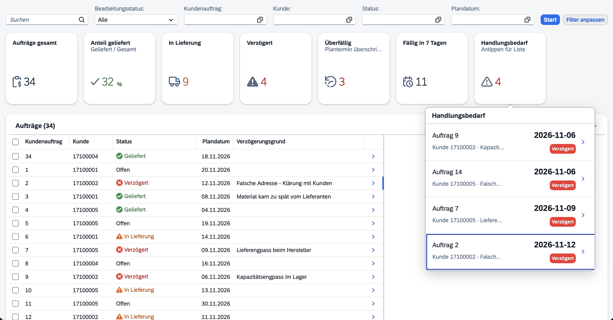
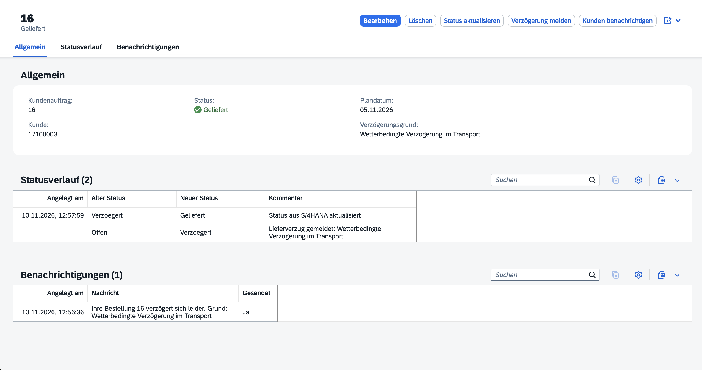
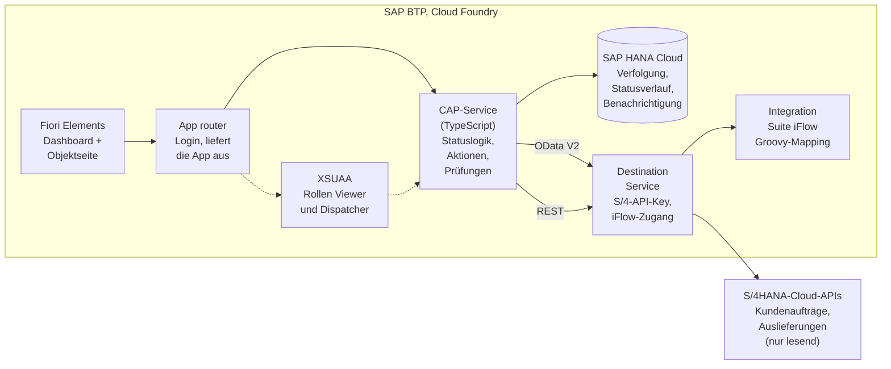

# LieferStatus-Hub

*English Version: [🇬🇧 README.en.md](README.en.md)*

[](https://github.com/nizeyimanaissa-hub/lieferstatus-hub/actions/workflows/test.yml)

Eine Clean-Core-Side-by-Side-Erweiterung auf **SAP BTP**: Auftrags- und Lieferstatus aus S/4HANA in einer Fiori-App, mit Kundenbenachrichtigung über **SAP Integration Suite**. Entstanden als Portfolio-Projekt mit **SAP CAP (Node.js, TypeScript), Fiori Elements, HANA Cloud und XSUAA**. S/4HANA selbst bleibt unverändert.

## Demo

Screenshots unten

| Dashboard mit KPI-Kacheln, „Handlungsbedarf“-Popover und Auftragstabelle |
|---|
|  |

| Objektseite mit Statusverlauf und Benachrichtigungen |
|---|
|  |

## Was die App kann

| Funktion | Für | Besonderheiten |
|---|---|---|
| **Dashboard** | Disponenten, Leser | KPI-Kacheln (gesamt, Anteil geliefert, in Lieferung, verzögert, überfällig, fällig in 7 Tagen) über der Auftragstabelle. Ein Klick auf eine Kachel filtert die Tabelle, ein zweiter Klick hebt den Filter auf. Die Kachel „Handlungsbedarf“ öffnet ein Popover mit verzögerten und überfälligen Aufträgen |
| **Auftragsliste** | Disponenten, Leser | Eine Liste aller verfolgten Kundenaufträge mit farbigem Status: *Offen*, *In Lieferung*, *Geliefert*, *Verzögert* |
| **Status aktualisieren** | Disponenten | Liest Kundenauftrag und Auslieferung live aus den S/4HANA-APIs und berechnet den Status neu |
| **Verzögerung melden** | Disponenten | Aktion mit Pflichtgrund; Grund und Statuswechsel landen in einem schreibgeschützten Statusverlauf |
| **Kunden benachrichtigen** | Disponenten | Ruft einen iFlow in der Integration Suite auf, der die Daten in eine deutsche Kundennachricht umwandelt; jeder Versuch wird protokolliert, auch Fehlschläge |
| **Entwurfsbearbeitung** | Disponenten | Verfolgungen als Entwurf anlegen und bearbeiten; die Prüfung läuft beim Sichern. Der Button „Neu anlegen“ ist für Leser ausgeblendet |

## Architektur



Der CAP-Service trennt die Zuständigkeiten Schicht für Schicht:

```text
db/schema.cds (OrderTracking, StatusLog, Notification)
  → srv/tracking-service.cds (Draft-Service, Aktionen, @restrict)
  → srv/tracking-service.ts (Handler) + srv/lib/status.ts (reine Statusregeln)
  → app/trackingapp (Fiori Elements: Annotationen, dazu eine eigene Dashboard-Seite in ext/dashboard)
```

## So wird der Status berechnet

Die Regeln stehen in einer reinen Funktion, [`srv/lib/status.ts`](srv/lib/status.ts), und gelten in dieser Reihenfolge:

1. Warenausgang abgeschlossen → **Geliefert**
2. Verzögerung manuell gemeldet → **Verzögert**
3. Lieferung angelegt → **In Lieferung**
4. Plandatum überschritten → **Verzögert**
5. Sonst → **Offen**

## Technische Highlights

- **Clean Core:** Alle Daten aus S/4HANA kommen über freigegebene Standard-APIs (`API_SALES_ORDER_SRV`, `API_OUTBOUND_DELIVERY_SRV`). Die Erweiterung besitzt nur eigene Tabellen.
- **Remote-Services in CAP:** Die S/4-APIs sind als externe Modelle importiert und werden in Entwicklung und Tests aus lokalen CSV-Daten simuliert. Auf der BTP liest derselbe Code über Destinations.
- **Geheimnisse in Destinations, nicht im Code:** API-Key und iFlow-Zugangsdaten liegen in BTP-Destinations. Lokal stehen sie in einer von Git ignorierten privaten Datei.
- **Autorisierung in zwei Schichten:** Der ganze Service verlangt einen Login, und `@restrict` schränkt die Verfolgungs-Entität ein: *Viewer* darf lesen, *Dispatcher* darf zusätzlich Aktionen ausführen. XSUAA setzt das auf der BTP durch, lokal übernehmen simulierte Benutzer das.
- **Dashboard auf einer Seite:** Eine eigene Fiori-Elements-Seite vereint KPI-Kacheln, die Standard-Filterleiste und die Standardtabelle. Die Kacheln sind einfache UI5-Controls, gespeist aus einer OData-Abfrage; ein Klick setzt Bedingungen in der Filterleiste, sodass die Tabelle über den normalen Fiori-Mechanismus filtert. Die KPI-Werte folgen den Filtern für Kundenauftrag und Kunde.
- **Berechtigungsbewusste Oberfläche:** Eine kleine Service-Funktion `userPermissions()` sagt der Oberfläche, ob der Benutzer Disponent ist. Leser sehen so keinen Anlegen-Button, der nur mit 403 scheitern würde. Der Service setzt die Regel weiterhin durch.
- **Geschäftsregeln in einer einfachen Funktion:** Die Statusberechnung hat keine CAP-Abhängigkeit und nimmt `today` als Parameter. So lässt sie sich ohne Uhr-Mocking testen.
- **Prüfung beim Sichern:** Der Kundenauftrag muss in S/4HANA existieren, pro Auftrag gibt es nur eine Verfolgung, und das Plandatum darf nicht in der Vergangenheit liegen.
- **Verständliche Fehler:** Ist S/4HANA nicht erreichbar, antwortet *Status aktualisieren* mit einer übersetzten Meldung statt mit einem Stacktrace. Lehnt S/4HANA die Zugangsdaten ab (HTTP 401/403), sagt die Meldung das auch, damit ein falscher API-Key nicht wie ein Ausfall aussieht. Eine fehlgeschlagene Benachrichtigung wird protokolliert und als Warnung angezeigt, nicht verschluckt.
- **Übersetzbare Meldungen und Oberfläche:** Service-Meldungen (`_i18n/`) und Dashboard-Texte (`app/trackingapp/webapp/i18n/`) gibt es auf Englisch und Deutsch.
- **Nachvollziehbarkeit:** Jeder Statuswechsel schreibt einen Verlaufseintrag mit altem Status, neuem Status und Grund.

## Qualität

| Prüfung | Umfang | Ergebnis |
|---|---|---|
| Jest-Unit-Tests | Statusregeln (ein Test pro Regel und Priorität) und die Zuordnung von S/4HANA-Fehlern zu Meldungen | 7 grün |
| `cds.test`-Servicetests | Ganze App im Speicher über HTTP: Liste, Verzögerungsaktion, Prüfungen, Autorisierung (Viewer erhält 403), Benutzerberechtigungen, Aktualisierung gegen die S/4-Mocks, fehlgeschlagene Benachrichtigung | 8 grün |
| TypeScript | `tsc --noEmit` für Handler und Tests | Keine Fehler |
| ESLint | CDS-Modelle mit `@sap/eslint-plugin-cds` | Keine Befunde |
| GitHub Actions | `npm ci` und `npm test` bei jedem Push und Pull Request | Badge oben |

Die Servicetests laufen gegen SQLite im Speicher mit simulierten S/4-APIs und ohne iFlow. Sie funktionieren daher auf jedem Rechner und in der CI ohne Zugangsdaten.

## Projektstruktur

```text
db/                    CDS-Datenmodell und Beispieldaten
srv/                   Service-Definition, Handler, externe API-Modelle und Mock-Daten
srv/lib/status.ts      Reine Statusberechnung
app/trackingapp/       Fiori-Elements-App (Annotationen, Manifest, eigene Dashboard-Seite in webapp/ext/dashboard)
_i18n/                 Service-Meldungen, Englisch und Deutsch
test/                  Unit- und Servicetests
mta.yaml               Deployment nach Cloud Foundry (App router, srv, HANA, XSUAA, Destination)
xs-security.json       Scopes, Rollen und Rollensammlungen
.deploy/app-router/    App-router-Konfiguration
```

## Lokal starten

```bash
npm install
cds watch        # simulierte S/4-APIs, keine Keys nötig
```

Anmeldung mit `anna` / `123` (Dispatcher) oder `ben` / `123` (Viewer). Bei `ben` ist der Anlegen-Button ausgeblendet, und die Aktions-Buttons werden abgelehnt.

```bash
npm test         # Unit- und Servicetests
```

## Auf SAP BTP deployen

Voraussetzung sind ein BTP-Trial-Account mit Cloud Foundry, eine SAP-HANA-Cloud-Instanz, die deinem Space zugeordnet ist, und die beiden Destinations `S4_SANDBOX` und `LIEFERSTATUS_IFLOW`.

```bash
mbt build
cf deploy mta_archives/lieferstatus-hub_1.0.0.mtar
```

Wichtige Destination-Einstellungen:

- **`S4_SANDBOX`:** URL `https://sandbox.api.sap.com`, dein API-Key steht in der zusätzlichen Eigenschaft `URL.headers.APIKey`. Ein fehlender oder falscher Key zeigt sich als „S/4HANA hat die Zugangsdaten abgelehnt“.
- **`LIEFERSTATUS_IFLOW`:** Die URL muss die **Basis** der Integration-Suite-Runtime sein und auf `/http` enden (zum Beispiel `https://<tenant>.it-cpitrial06-rt.cfapps.us10-001.hana.ondemand.com/http`), dazu die iFlow-Zugangsdaten. Die App hängt `/lieferstatus/notify` selbst an, daher gehört dieser Pfad nicht in die Destination.

Danach die Rollensammlung `LieferStatus_Dispatcher` oder `LieferStatus_Viewer` dem eigenen Benutzer zuweisen und die App-router-URL öffnen. Die Trial-HANA-Instanz stoppt jede Nacht; vor einer Demo in HANA Cloud Central starten.

## Einschränkungen

- „Geliefert“ basiert auf dem Warenausgang. Ein echter Liefernachweis ist nicht abgebildet.
- Das Dashboard liest bis zu 1.000 Aufträge und berechnet die KPIs im Browser. Bei deutlich größeren Datenmengen sollte das auf serverseitige Aggregation (`$apply`) umgestellt werden.
- Die KPI-Kacheln folgen den Filtern für Kundenauftrag und Kunde, nicht der Freitextsuche und nicht einem von Hand gesetzten Status- oder Datumsfilter.
- Die Sandbox-APIs sind schreibgeschützt, daher liegen Statusänderungen in den eigenen Tabellen der App und nicht in S/4HANA.
- ESLint prüft die CDS-Modelle, aber nicht die TypeScript-Dateien, weil die TypeScript-7-Toolchain von `typescript-eslint` noch nicht unterstützt wird. Die Typen prüft `tsc`.
- Die Tests laufen auf SQLite. SQL, das nur HANA ablehnt, kann sie bestehen (siehe unten).

## Was ich gelernt habe

Die Tests liefen durch, während die App auf HANA scheiterte: Ein `case status when 'X'`-Ausdruck, den SQLite akzeptiert, lehnt HANA Cloud ab, und nur die deployte App hat es gezeigt. Seitdem gilt für mich ein grüner Testlauf als notwendig, aber nicht ausreichend, und ich prüfe zusätzlich die deployte App. Zwei weitere Fälle derselben Art: Eine Destination-URL, die den iFlow-Pfad schon enthielt, ließ die App `…/notify/lieferstatus/notify` aufrufen, was sich nur in der deployten App als 404 zeigte. Und ein CSV-Wert mit Komma wurde lokal stillschweigend abgeschnitten, von HANA aber abgelehnt. Außerdem habe ich gelernt, zuerst die Cloud-Foundry-Logs zu lesen: Die Abstürze auf der BTP kamen von Build-Ausgaben und fehlenden Start-Skripten, nicht vom Code.

## Eingesetzte Technologien

SAP BTP (Trial) · SAP CAP (Node.js, TypeScript) · CDS · OData V2 und V4 · Fiori Elements · SAP HANA Cloud · XSUAA · Destination Service · SAP Integration Suite (Cloud Integration, Groovy) · Jest · `@cap-js/cds-test` · GitHub Actions · MTA

## Autor

Issa Hirwa Nizeyimana · [LinkedIn](https://www.linkedin.com/in/issa-hirwa-nizeyimana-245a393bb)
