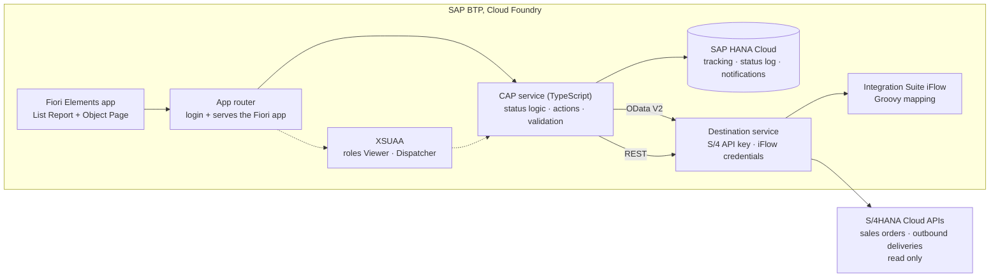

# LieferStatus-Hub

[](https://github.com/nizeyimanaissa-hub/lieferstatus-hub/actions/workflows/test.yml)

A clean-core side-by-side extension on **SAP BTP**: order and delivery status from S/4HANA in one Fiori app, with customer notifications through **SAP Integration Suite**. Built as a portfolio project with **SAP CAP (Node.js, TypeScript), Fiori Elements, HANA Cloud and XSUAA**. S/4HANA itself stays untouched.

> **Kurz auf Deutsch:** Erweiterung auf SAP BTP, die Kundenaufträge und Lieferungen aus S/4HANA zusammenführt, Verzögerungen mit Grund erfasst und Kunden über einen iFlow benachrichtigt. Standard-S/4HANA bleibt unverändert.

## Demo

[2-minute video](#) · screenshots below

| List Report | Object Page |
|---|---|
|  |  |

| Notification in Integration Suite monitoring |
|---|
|  |

## What it does

| Feature | For | Highlights |
|---|---|---|
| **Order tracking list** | Dispatchers, viewers | One list of tracked sales orders with status as a coloured tag: *Offen*, *In Lieferung*, *Geliefert*, *Verzögert* |
| **Refresh status** | Dispatchers | Reads the sales order and its outbound delivery live from the S/4HANA APIs and recalculates the status |
| **Report a delay** | Dispatchers | Action with a mandatory reason; the reason and the status change go into a read-only status history |
| **Notify customer** | Dispatchers | Calls an iFlow in Integration Suite, which maps the data to a German customer message; every attempt is logged, including failures |
| **Draft editing** | Dispatchers | Create and edit trackings as drafts; validation runs when saving |

## Architecture



The CAP service has one projection per concern:

```text
db/schema.cds (OrderTracking, StatusLog, Notification)
  → srv/tracking-service.cds (draft-enabled service, actions, @restrict)
  → srv/tracking-service.ts (handlers) + srv/lib/status.ts (pure status rules)
  → app/trackingapp (Fiori Elements, annotations only)
```

## How the status is calculated

The rules live in one pure function, [`srv/lib/status.ts`](srv/lib/status.ts), and apply in this order:

1. Goods issue completed → **Geliefert**
2. Delay reported manually → **Verzögert**
3. Delivery created → **In Lieferung**
4. Planned date has passed → **Verzögert**
5. Otherwise → **Offen**

## Technical highlights

- **Clean core:** all data from S/4HANA comes through the released standard APIs (`API_SALES_ORDER_SRV`, `API_OUTBOUND_DELIVERY_SRV`). The extension owns only its own tables.
- **Remote services in CAP:** the S/4 APIs are imported as external models and mocked from local CSV data in development and tests. On BTP the same code reads from destinations.
- **Secrets in destinations, not in code:** the API key and the iFlow credentials live in BTP destinations. Locally they sit in a git-ignored private file.
- **Authorization in two layers:** the whole service requires a login, and `@restrict` limits the tracking entity: *Viewer* can read, *Dispatcher* can also run actions. XSUAA enforces it on BTP, mocked users enforce it locally.
- **Business rules in a plain function:** the status calculation has no CAP dependency and takes `today` as a parameter, so it is unit-tested without mocking the clock.
- **Validation on save:** the sales order must exist in S/4HANA, a tracking can exist only once per order, and the planned date must not be in the past.
- **Readable errors:** if S/4HANA is down, *Refresh Status* answers with a translated "not reachable" message instead of a stack trace. A failing notification is logged and shown as a warning, not lost.
- **Translatable messages:** service messages are in English and German (`_i18n/`).
- **Audit trail:** every status change writes a log entry with old status, new status and the reason.

## Quality

| Check | Scope | Result |
|---|---|---|
| Jest unit tests | Status rules, one test per rule and priority | 5 green |
| `cds.test` service tests | Whole app in memory over HTTP: list, delay action, validation, authorization (Viewer gets 403), refresh against the S/4 mocks, failed notification | 7 green |
| TypeScript | `tsc --noEmit` on handlers and tests | No errors |
| ESLint | CDS models with `@sap/eslint-plugin-cds` | No findings |
| GitHub Actions | `npm ci` and `npm test` on every push and pull request | Badge above |

The service tests run against SQLite in memory with mocked S/4 APIs and no iFlow, so they work on any machine and in CI without credentials.

## Repository structure

```text
db/                    CDS data model and sample data
srv/                   Service definition, handlers, external API models and mock data
srv/lib/status.ts      Pure status calculation
app/trackingapp/       Fiori Elements app (annotations, manifest)
_i18n/                 Service messages, English and German
test/                  Unit and service tests
mta.yaml               Deployment to Cloud Foundry (app router, srv, HANA, XSUAA, destination)
xs-security.json       Scopes, roles and role collections
.deploy/app-router/    App router configuration
```

## Run it locally

```bash
npm install
cds watch        # mocked S/4 APIs, no keys needed
```

Log in with `anna` / `123` (Dispatcher) or `ben` / `123` (Viewer). As `ben` the action buttons are rejected.

```bash
npm test         # unit and service tests
```

## Deploy to SAP BTP

You need a BTP trial account with Cloud Foundry, an SAP HANA Cloud instance mapped to your space, and the two destinations `S4_SANDBOX` and `LIEFERSTATUS_IFLOW`.

```bash
mbt build
cf deploy mta_archives/lieferstatus-hub_1.0.0.mtar
```

Then assign the role collection `LieferStatus_Dispatcher` or `LieferStatus_Viewer` to your user and open the app router URL. The trial HANA instance stops every night; start it in HANA Cloud Central before a demo.

## Limitations

- "Delivered" is based on goods issue. Real proof of delivery is not modelled.
- The sandbox APIs are read only, so status changes live in the app's own tables, not in S/4HANA.
- ESLint covers the CDS models but not the TypeScript files, because the TypeScript 7 toolchain is not yet supported by `typescript-eslint`. `tsc` checks the types.
- The tests run on SQLite. SQL that only HANA rejects can pass them (see below).

## What I learned

The test setup passed while the app failed on HANA: a `case status when 'X'` expression that SQLite accepts is rejected by HANA Cloud, and only the deployed app showed it. Since then I treat a green test run as necessary but not sufficient, and I check the deployed app too. I also learned to read the Cloud Foundry logs first: the crashes on BTP came from build output and missing start scripts, not from the code.

## Built with

SAP BTP (trial) · SAP CAP (Node.js, TypeScript) · CDS · OData V2 and V4 · Fiori Elements · SAP HANA Cloud · XSUAA · Destination service · SAP Integration Suite (Cloud Integration, Groovy) · Jest · `@cap-js/cds-test` · GitHub Actions · MTA

## Author

Issa Hirwa Nizeyimana · [LinkedIn](https://www.linkedin.com/in/issa-hirwa-nizeyimana-245a393bb)
